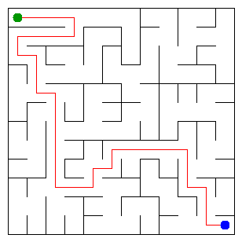

# Assignment 3 — Maze Escape (Java 17+)

> **Personalized learning/reference project for Student ID 253466.** The input files were generated with `java tools/MakeVariant.java 253466 data`, and the result below was obtained by running `Main` on these data. You should understand and adapt the code before submission. Authentic Git history is not included. The benchmark table below contains results from the student’s own laptop, provided from an IntelliJ IDEA run.

Student ID: **253466**  
Name: **Mekhrinsa Idrissova**  
Group: **SE-2510**  
Maze size: **12 x 12**

## Run

```bash
java tools/MakeVariant.java 253466 data
javac -d out src/*.java
java -cp out Main
java tools/Check.java
java -cp out Bench
```

On headless Linux, `java -Djava.awt.headless=true -cp out Main` can be used to generate the PNG without a display server. `output/maze.html` opens in a browser. Re-run `Main` after generating your personal files.

## Program output (Student ID 253466)

```text
Broken: 143
Kept: 121
Last broken wall: 231
MST cost: 39908
Heaviest broken wall: 890
Path length: 32
DFS visited: 104
Dead ends: 44
Zones: 10
Largest zone: 23
Is DAG: 0
Flow stages: 8
Fastest route cost: 4
```



## Questions — explanations to study and rewrite in your own words

**Mission 0.** `find` returns the representative of a component; path compression makes subsequent root queries faster. `union` merges distinct components, attaching the smaller tree below the larger one, and decreases the component count.

**Mission 1.** There are `R*C` initially disconnected vertices and breaking any accepted wall joins two components. Exactly `R*C-1` merges are needed to connect all vertices; out of `R(C-1)+(R-1)C` interior walls, the unbroken count is `(R-1)(C-1)`.

**Mission 2.** Kruskal considers every wall in increasing cost and uses DSU to avoid cycles. Prim grows a tree by repeatedly choosing the cheapest edge crossing to a new vertex. The MST cut property guarantees their equal minimum totals. For Student ID 253466, MST cost: 39908.

**Mission 3.** The broken-wall graph is a tree: it is connected and acyclic, so every two cells have exactly one simple path. An explicit stack and next-neighbor indices replace recursive DFS, avoiding Java call-stack overflow on very large mazes.

**Mission 4.** Kosaraju explores vertices in decreasing first-pass finishing order on the reversed graph, which isolates one strongly connected component per DFS. With no self-loops, a directed cycle exists exactly when one SCC contains at least two vertices; therefore the slides are acyclic precisely when every cell is its own SCC.

**Mission 5.** The SCC condensation graph is acyclic, and assigning SCC IDs by the second DFS order makes every cross-zone edge go from a smaller to a larger ID. Relaxing edges in ID order is therefore a topological DP, taking O(Z+S) time when processing every slide (Z zones, S slides).

## AI use — disclosure

**ChatGPT (OpenAI)** was used to generate an initial reference implementation, customize the project to Student ID 253466, explain algorithms, review and test the implementation, and prepare this README. The benchmark results below were recorded on the student’s own laptop using Java 26 and IntelliJ IDEA, based on the run output provided by the student. **Review, edit, and be able to explain all code yourself before academic submission.** Follow your course rules: unmodified AI-generated work submitted as your own is not allowed. Describe your actual use accurately.### AI use

I used ChatGPT to understand Git commands, troubleshoot GitHub authentication and push errors, and organize commits. I reviewed the suggested steps and tested the changes in IntelliJ IDEA.

## Timing (measured on my own laptop)

Bench was run five times for each maze size on my own laptop using Java 26 and IntelliJ IDEA. The table shows the individual measurements and their average execution times.

| Maze | Kruskal runs (ms) | Kruskal average (ms) | Prim runs (ms) | Prim average (ms) |
|---|---|---:|---|---:|
| 100 x 100 | 24, 10, 14, 16, 21 | 17 | 30, 17, 11, 15, 13 | 17 |
| 300 x 300 | 152, 76, 54, 50, 47 | 76 | 264, 140, 133, 130, 133 | 160 |
| 1000 x 1000 | 1004, 804, 1026, 1241, 2093 | 1234 | 3304, 2997, 3172, 4731, 4913 | 3824 |

As the maze size increases, the execution time of both algorithms increases. For 100 x 100, both algorithms had the same reported average of 17 ms. For the larger mazes, Kruskal was faster than Prim on my laptop. For 1000 x 1000, Kruskal averaged 1234 ms and Prim averaged 3824 ms. Minor variation between runs may be caused by JVM warm-up and system activity.

## Complexity

Let V be the number of cells, E the number of walls or slides, and Z the number of zones.

| Algorithm | Time | Extra space | Assumptions |
|---|---|---|---|
| DSU find/union | amortized O(alpha(V)) | O(V) total DSU storage | path compression and union by size |
| Kruskal | O(E log E) | O(E+V) | comparison sort |
| Prim | O(E log E) | O(E+V) | binary priority queue |
| DFS | O(V+E) | O(V+E) | adjacency lists, iterative DFS |
| Kosaraju | O(V+E) | O(V+E) | two iterative graph traversals |
| Route in zone graph | O(Z+E) | O(Z+E) | topologically numbered zones |

## Before you submit

- `data/walls.txt` and `data/slides.txt` are already generated for Student ID 253466.
- The 13 numbers and visualization already correspond to these data; verify by re-running `Main`.
- Run `java tools/Check.java` to recheck the implementation. Your own Bench measurements are included above; rerun `java -cp out Bench` if you change code or want updated measurements.
- Understand the algorithms, rewrite the explanations in your own words, make and test your own improvements, and accurately disclose AI assistance.
- Create a **public GitHub repo** with real commits after each mission (a ZIP cannot create genuine prior work history).
- Push all source code, personal input files, `output/maze.png`, README and submit the public link in Moodle.
